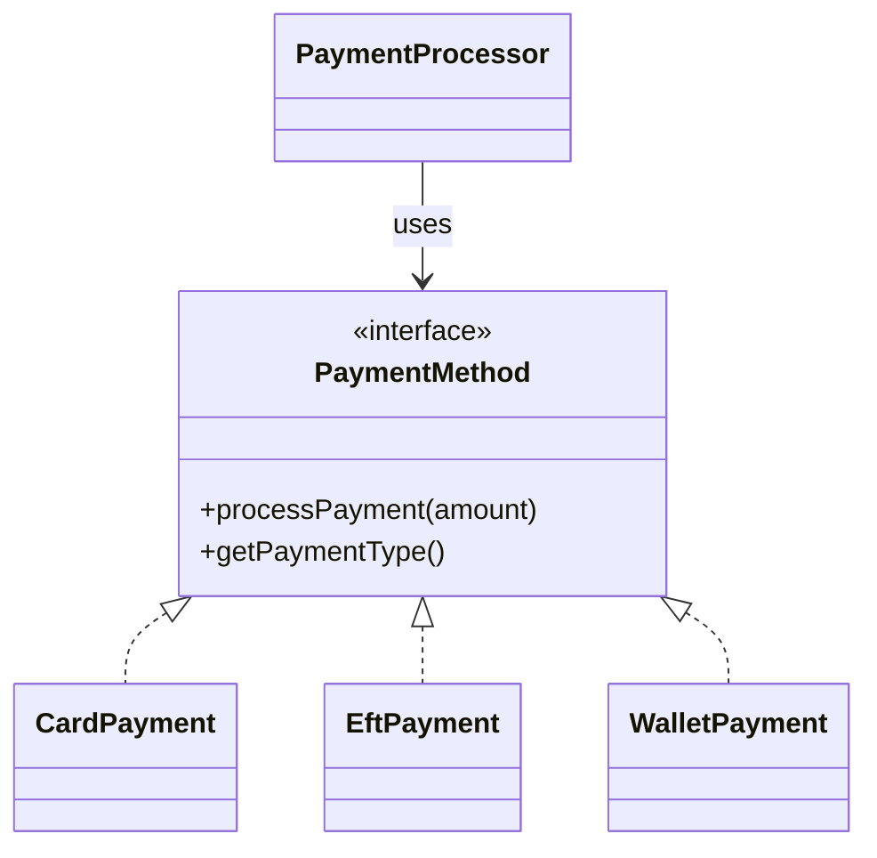

# PayNest Merchant Order Desk and Catalogue Engine
## Project Description
PayNest is a Java console application designed to demonstrate customer, product, order and payment management.

The application allows merchants to create customer orders, calculate totals accurately, print receipts and process simulated payments using different payment methods.

The project combines object-oriented programming, interfaces, polymorphism, validation and automated testing.

## Technologies Used
- Java 21
- Apache Maven
- JUnit 5
- BigDecimal for monetary calculations
- IntelliJ IDEA

## Project Structure
The application is organised into four packages.

### Domain —
com.paynestsystem.domain
- Customer — stores customer details.
- Product — represents products and prices.
- OrderItem — stores a purchased product and quantity.
- Order — manages order items and calculates totals.
### Service —
com.paynestsystem.service
- OrderService — creates orders, coordinates receipt printing and manages checkout. 
- ReceiptPrinter — displays formatted order receipts.
### Payment —
com.paynestsystem.payment
- PaymentMethod — interface defining common payment operations.
- CardPayment — simulates card payments.
- EftPayment — simulates electronic funds transfer payments.
- WalletPayment — simulates wallet payments using an available balance. Payments are declined when the amount exceeds the balance, while successful payments deduct the amount from the wallet.
- PaymentProcessor — processes payments through the selected payment method.
### Application —
com.paynestsystem.app
- PayNestApplication — demonstrates the ordering and checkout process.
### Key Features
Order Management
Customers can have orders containing multiple products. Each item’s subtotal is calculated using its price and quantity, and the subtotals are added to determine the order total.

### Payment Architecture Diagram



## Multiple Payment Methods
PayNest supports three simulated payment methods:

Card
EFT
Wallet
All three implement the PaymentMethod interface.
### Wallet Balance Validation
Unlike Card and EFT payments, Wallet payments have an additional business rule.

- Each wallet has an available balance.
- Payments exceeding the available balance are declined and return false.
- Successful payments deduct the amount from the wallet balance.
- Wallet balances cannot be negative.
- A wallet with a zero balance is valid but cannot process a positive payment.
- This demonstrates how different payment methods can implement their own business rules while sharing the same PaymentMethod interface.

The PaymentProcessor accepts any implementation of this interface, demonstrating polymorphism without requiring separate checkout logic for each payment type.

## Checkout Integration
The checkout process retrieves the total from the existing Order class and passes it to the payment processor.

The application then displays whether payment processing succeeded or failed.

## Validation
The application validates customer, product and order information, including positive IDs, nonblank required fields and valid quantities.
### Shared Payment Validation:
Payment amount validation is centralised in the PaymentMethod interface through the ```text validateAmount()``` default method.

This allows Card, EFT, Wallet and PaymentProcessor to reuse the same validation logic instead of repeating it in multiple classes. The method rejects null, zero and negative payment amounts.

Individual payment methods can still apply additional rules, such as the wallet’s insufficient-balance check.

Payment processing rejects null payment methods and amounts that are zero or negative.

## Monetary Accuracy
BigDecimal is used for order and payment calculations to avoid floating-point precision problems.

Receipts use South African Rand currency formatting.

## Design Decisions
Encapsulation: Domain fields are private, and the order’s item collection is exposed as an unmodifiable list.

Separation of responsibilities: Domain classes handle order data and calculations, service classes coordinate operations, and payment classes implement payment behaviour.

Polymorphism: Different payment methods can be processed through the same PaymentMethod interface.

Extensibility: Additional payment methods can be introduced by implementing PaymentMethod, without rewriting the existing order calculations.

## Why Use Interfaces Instead of a Single Mega-Method?
Using the PaymentMethod interface allows PayNest to support different payment methods without putting all the payment logic into one large method filled with if/else or switch statements.
Each payment class is responsible for its own behaviour, while PaymentProcessor works with them through a common interface. This makes the code easier to understand, test and maintain.
It also allows new payment methods to be added without changing the existing payment processor, making the application more flexible as it grows.

### How to Build and Test
Ensure Java 21 and Apache Maven are installed.

From the project root, run:

```bash
mvn clean test
```
*This command compiles the project and runs the JUnit tests when Maven dependencies are available.*

Test verification:
- The project was successfully built and tested using Apache Maven. All 19 automated tests passed with 0 failures, 0 errors and 0 skipped tests.
- The Maven build completed successfully.

### How to Run
From the project root:

```bash
mvn compile
java -cp target/classes com.paynestsystem.app.PayNestApplication
```
*Alternatively, open PayNestApplication.java in IntelliJ IDEA and run its main() method.*

The sample application creates an order and processes payment using the selected payment method.

## Example Output

The following is an example of the application output:
```text
======== PAYNEST RECEIPT ========
Order #: 1001
Customer: Nolwazi
Email: nolwazi.mrobongwane@umuzi.org
--------------------------------------
Laptop x 1 = R12 000,00
Mouse x 2 = R500,00
--------------------------------------
Total: R12 500,00
===================================
Processing Card Payment for R12500.00
Payment successful via Card Payment
Amount: R12500.00
Order #1001 has been processed successfully.
```

*Currency spacing and separators depend on the Java formatting configuration.*

## Demonstrating the Payment Methods
To demonstrate the application’s payment functionality:

- Open PayNestApplication.java in IntelliJ IDEA.
- Run the main() method to create a sample customer order and display its receipt.
- Locate the payment method selected in the checkout code.
- Select CardPayment and run the application. Confirm that the card payment is processed successfully.
- Change the selected payment method to EftPayment and run the application again.
- Repeat the demonstration using WalletPayment.
- Verify that each payment method processes the same order total and displays the appropriate payment confirmation.
- The demonstration shows how different payment implementations can be used through the same interface without changing the existing order calculation logic.

*All payment methods are simulated; no real transactions take place.*

## Automated Testing
The project contains tests covering:

- Order item and grand total calculations
- Empty orders
- Invalid quantities and null references
- Decimal prices and large quantities
- Receipt content and currency formatting
- Card, EFT and Wallet payment processing
- Invalid payment methods and payment amounts
- OrderService checkout integration
- Insufficient wallet balance returning false during payment processing.
- Unsuccessful order checkout when the wallet cannot cover order total.

*Latest IntelliJ test result: 19 tests passed, 0 failed.*

## Future Improvements
Potential enhancements include persistent order storage, inventory management, real payment gateway integrations, transaction references and more detailed payment status tracking.

Note: All payment methods are simulated. No real financial transactions are performed.
